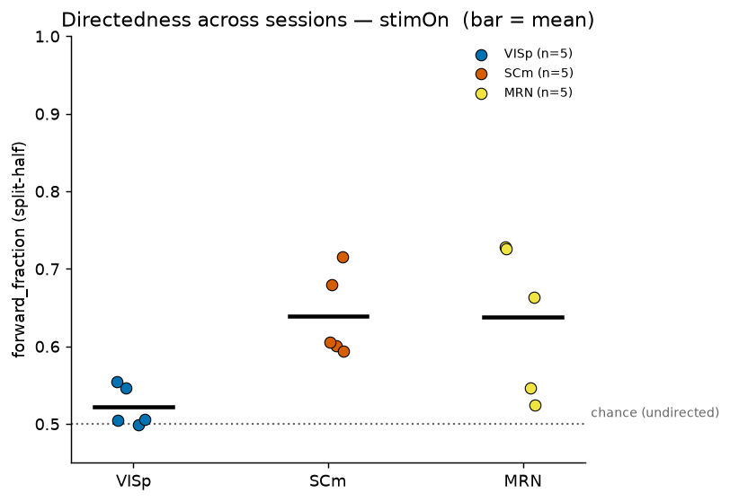
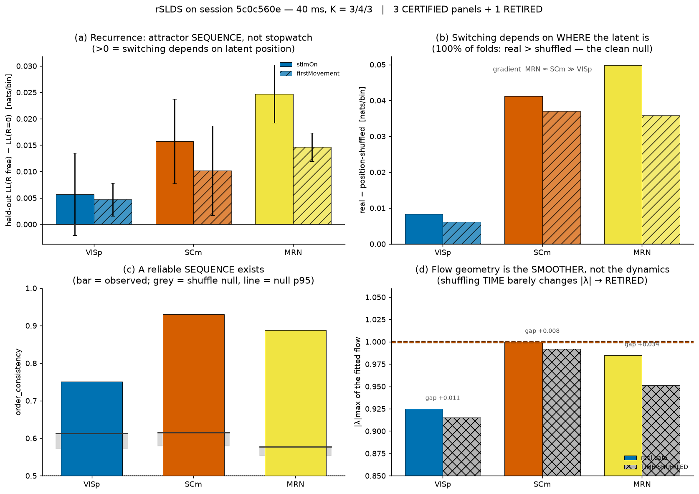
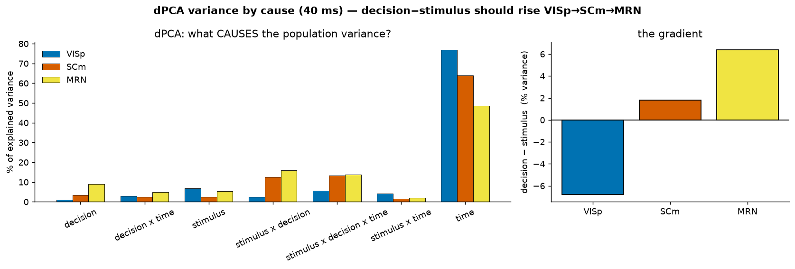

# IBL Decision Dynamics

[](https://github.com/teo-fantacci/neuroDataReHack2026/actions/workflows/tests.yml)
[](LICENSE)

**NeuroDataReHack 2026, HHMI Janelia, 11–17 July 2026.** A reanalysis of the IBL Brain-Wide Map
([DANDI:000409](https://dandiarchive.org/dandiset/000409); IBL et al. 2025, *Nature* 645:177–189)
asking whether a perceptual decision unfolds as a **sequence of metastable population states**
that is shared across brain areas but expressed differently in each. We study the one
visual-to-motor axis that IBL records simultaneously in at least five mice, **VISp** (primary
visual cortex), **SCm** (motor superior colliculus) and **MRN** (midbrain reticular nucleus), with
Poisson hidden Markov models, recurrent switching linear dynamical systems (rSLDS) and demixed
dimensionality reduction. Claims are tested against null models or a planted ground truth, and
the repository keeps the record of what was certified, what is still a lead, and what was
retracted.

## Key results

**1. Motor areas move through their states in a consistent order; visual cortex does not.**
SCm is directed in all five mice and MRN on average (two mice sit near chance). VISp is undirected
in all five. The pattern holds under both stimulus and movement alignment.



*Poisson-HMM `forward_fraction` (split-half), one dot per mouse. 0.5 means transitions go
forward and backward equally often; 1.0 means a strict forward chain.*

**2. The states form a position-dependent sequence, not a timed script. The "line attractor"
reading was retracted.**



*rSLDS on the working session `5c0c560e`, computed on the earlier 0.4 s-baseline tensors. Panels
a–c: switching depends on where the latent state is, strongly in SCm and MRN and weakly in VISp,
and the order of states is reproducible across trials. Panel d shows why the
attractor-geometry claim was withdrawn: shuffling time barely changes the fitted |λ|, so it is set
by the smoother, not by the dynamics.*

**3. Lead, not yet a claim: decision variance grows from visual to motor areas.**



*dPCA on the working session. Decision-minus-stimulus variance rises from VISp to SCm to MRN.
Session `111c1762`, which has the cleanest VISp recording, does not reproduce this gradient, so it
needs the five sessions pooled before it can be claimed.*

### Status in one place

| Finding | Status |
|---|---|
| A reliable, position-dependent sequence of states exists in all three areas (rSLDS recurrence test beats a position-shuffle null in every fold) | ✅ certified, one session |
| Motor areas traverse their states directedly, VISp does not. Pooled `forward_fraction`: VISp 0.52, SCm 0.64, MRN 0.64 | ✅ certified direction (SCm 5/5 mice, MRN 3/5) |
| The first evoked HMM state is locked to **movement**, not to the stimulus | ✅ certified (a caveat on every "decision" reading) |
| Decision variance and timescale grow from visual to motor areas (dPCA, GPFA) | 🔶 lead, one session |
| SCm and MRN share a common drive rather than a restricted channel (RRR, zero-lag correlogram, HMM) | 🔶 lead |
| "The states are line attractors / integrators" | ❌ retracted: an artefact of smoothing |
| A state-count gradient across areas | ❌ retracted: the count is about 3 everywhere |

Full, sourced status: [`docs/knowledge/project_synthesis_2026-07-15.md`](docs/knowledge/project_synthesis_2026-07-15.md).
Single-session effect sizes quoted in older docs (for example SCm 0.83) were corrected downwards by
the five-session replication; the pooled numbers above are the ones to use.

## Project phases and notebooks

Notebooks are numbered in run order and grouped by the phases of the
[project plan](docs/project_notes/Janelia_project_plan_with_2nd_dataset.md).

| Phase | Notebook | What it does |
|---|---|---|
| 0 · Setup and data | `00_data_smoketest` | Data-access check plus visual inspection: PSTHs, rasters, decoder |
| 0 · Setup and data | `01_preprocessing` | **Run first.** Builds the frozen tensors every model reads |
| 1 · Area selection | *(script)* `scripts/run_phase1.py` | Which regions IBL co-records; picks `{VISp, SCm, MRN}` |
| 2 · Dynamics backbone | `02_hmm_triplet` | Poisson HMM: state sequences, `forward_fraction`, K by state stability |
| 2 · Dynamics backbone | `03_rslds_triplet` | rSLDS (fast exact-EM plus Linderman's `ssm`): recurrence and order tests |
| 3 · Geometry | `04_dimred_msr` | PCA, dPCA, MDS, Laplacian, GPFA, RRR, joint manifold; MSR as a comparison |
| 3 · Geometry | `05_manifold_dpca_gpfa_rrr` | Legacy: merged into `04`; kept for the bin-by-smoothing sweep |
| 4 · Second dataset | `06_monkey_data_colleagueD` | Macaque working-memory data (FEF, DMFC): first look |
| 4 · Second dataset | `07_monkey_hmm` | Delay-aligned HMM, state-vs-task-phase, drift diagnosis |
| 4 · Second dataset | `08_monkey_dimred` | PCA, dPCA and FEF–DMFC communication subspace |
| 5 · Write-up | `09_hmm_summary` | The HMM strand: what was tested, what failed, what replicates |
| 5 · Write-up | `10_results_visualization` | Animations of the certified regime sequence |

Figures are written to `results/figures/<phase>_<topic>/` and are regenerated, not committed;
the three figures above are copied to [`docs/figures/`](docs/figures/).

## Setup

One conda environment runs everything:

```bash
conda create -n neurodatarehack python=3.11 -y
conda activate neurodatarehack
pip install -r requirements.txt                              # versions are pinned
python -m ipykernel install --user --name neurodatarehack    # register the Jupyter kernel once
nbstripout --install --attributes .gitattributes             # strip notebook outputs from commits
```

**The `ssm` environment is optional.** Linderman's `ssm`, the Poisson rSLDS used as the fit of
record, needs numpy 1.x, so it lives in a separate env, `ndrh_ssm`, and is called out of process.
The code detects whether it exists and otherwise falls back to the fast exact-EM rSLDS, which is
the engine behind the certified recurrence result. Build it only for the second-backend
cross-check, once and without admin rights: `bash scripts/install_ssm_env.sh`.

## Tests

```bash
pytest            # fast suite, about 15 s, synthetic data only, no downloads (this is what CI runs)
pytest -m slow    # full validations: rSLDS ground-truth sweep and the optional ssm bridge, about 6 min
```

The suite turns the project's two validation scripts into tests. Our HMM must score data exactly
as an independent implementation does: [dynamax](https://github.com/probml/dynamax), to machine
precision. The rSLDS must recover a planted three-state sequence at the project's 40 ms bin without
inventing a line attractor. Unit tests cover binning, the frozen preprocessing configuration and its
`.npz` round trip, the HMM read-outs, RRR and MSR.

## Data

Nothing is stored in git. No account is needed: ONE-api ships IBL's public `openalyx`
credentials.

- **IBL Brain-Wide Map** is read through ONE-api and `brainwidemap`, pinned to the paper freeze
  `2023_12_bwm_release`. A hash of the unit IDs is asserted, so the analysis uses **exactly** the
  paper's 62,990 units. Two upstream `brainwidemap` bugs are worked around in
  [`src/data/access.py`](src/data/access.py) (see the
  [Phase 0 worklog](docs/worklog/2026-07-08_phase0-setup.md)). The working session downloads about
  440 MB into `data/ONE/` on first run.
- **The same five sessions are on DANDI as NWB files** in
  [DANDI:000409](https://dandiarchive.org/dandiset/000409), created with NeuroConv. For the working
  session we checked that all units in the NWB units table carry the same IBL cluster UUIDs as the
  paper's unit tables, so the spike sorting is identical. The analysis currently reads data
  through ONE; an NWB loader is a planned addition.

  | Session | DANDI subject | Role |
  |---|---|---|
  | `5c0c560e` | `sub-NR-0028` | working session |
  | `90c61c38` | `sub-CSH-ZAD-025` | replicate |
  | `111c1762` | `sub-UCLA033` | replicate, cleanest VISp |
  | `90d1e82c` | `sub-DY-010` | replicate |
  | `8a3a0197` | `sub-UCLA034` | replicate |

- **Second dataset (phase 4):** macaque frontal cortex during a multi-object working-memory task,
  [DANDI:000620](https://dandiarchive.org/dandiset/000620) (Watters, Gabel, Tenenbaum and Jazayeri).
  The notebooks read a preprocessed spike-time file derived from it that a colleague shared; it
  is not redistributed here.

## Repository map

| Path | Contents |
|---|---|
| `src/data/` | `access.py` (ONE + reproducibility pins), `preprocess.py` (**the single preprocessing pipeline**), `build_matrices.py` (spikes to `(trials, time, neurons)` tensors), `select_areas.py`, `monkey.py` (DANDI:000620 loader) |
| `src/dynamics/` | `hmm.py` (Poisson HMM and read-outs), `rslds.py` (exact-EM rSLDS and sequence statistics), `rslds_ssm.py` (bridge to `ssm`), `dpca.py`, `gpfa.py`, `rrr.py` |
| `src/geometry/` | `embed.py` (embeddings), `joint.py` (joint-population PCA with per-area projections) |
| `src/selection/` | `msr.py` (multiscale relevance; evaluated, **not adopted**) |
| `src/viz/` | `style.py` (colour-vision-safe palette, `savefig`), `nap_plots.py`, `rslds_anim.py`, `anim3d.py` |
| `scripts/` | Headless versions of the analyses: data building (`build_processed_*`), HMM (`run_hmm_*`), rSLDS (`run_rslds_*`), figures (`plot_preprocessing_summary`, `build_session_recap`), monkey (`run_monkey_hmm_alignments`, `compare_hmm_mouse_monkey`), validation (`validate_*`) |
| `tests/` | pytest suite (see above) |
| `config/` | `areas.yaml` (selected regions and session), `params.yaml` |
| `docs/knowledge/` | Method and maths notes; `project_synthesis_*.md` is the executive status |
| `docs/worklog/` | Dated session logs, newest first: what was decided and why |
| `docs/project_notes/` | The pre-hackathon plan (static) |

Conventions that matter: tensors are `(trials, time, neurons)` of **raw counts** (smoothing only for
geometry and plots); bins are **40 ms** everywhere (20 ms manufactures fake integrators, 50 ms
degrades SCm state stability); single-trial models are fitted **per session** and their statistics
pooled, never on a cross-session pseudo-population.

## How AI coding agents were used

The analysis was developed with **Claude Code** (Anthropic) as a pair programmer. The scientific
question, the choice of regions and sessions, and the decision of what counts as certified were the
author's. Two files make the collaboration auditable:

- [`CLAUDE.md`](CLAUDE.md) holds the standing instructions given to the agent: conventions,
  verification rules, and a list of traps that already happened so they are not repeated.
- [`docs/worklog/`](docs/worklog/) records each session's decisions with the evidence behind them,
  including the ones that were reversed.

The rule was that an agent's output is a claim to verify, not a result. Examples from this repo:

- **A retracted headline.** The rSLDS first suggested line attractors, the result the project hoped
  for. A time-shuffle control reproduced more than 97 % of the fitted |λ|, so the claim was withdrawn
  (figure 2, panel d).
- **An independent implementation.** The HMM likelihood was checked against dynamax to machine
  precision before any model comparison was trusted. That check is now a test.
- **A planted ground truth.** The rSLDS had to recover a known sequence before being run on data.
  That exposed a "sticky" prior that was silently being overwritten, and showed that 20 ms bins
  produce spurious integrators.
- **A misdiagnosis caught.** The agent once recorded the published `ssm` package as uninstallable.
  The error turned out to be two separate, fixable problems. The published implementation became
  the fit of record, and the faster in-house version was kept only as a cross-check.
- **Replication over one good session.** A directedness effect of 0.83 in one session became 0.64
  once all five mice were fitted, and the README reports the pooled number.

## License

The code is released under the [MIT License](LICENSE). No data are included. The IBL Brain-Wide
Map (DANDI:000409) and DANDI:000620 are distributed under CC-BY-4.0 by their authors. Cite the
original datasets when using them.

## Key references

IBL et al. 2025, *Nature* 645:177–189 · Linderman et al. 2017, AISTATS (rSLDS) · Genkin, Shenoy,
Chandrasekaran & Engel 2025, *Nature* 645:168–176 (NeuralFlow) · Langdon, Genkin & Engel 2023,
*Nat Rev Neurosci* 24:363–377 · Semedo et al. 2019, *Neuron* 102:249–259 (communication subspace) ·
Kobak et al. 2016, *eLife* 5:e10989 (dPCA).
